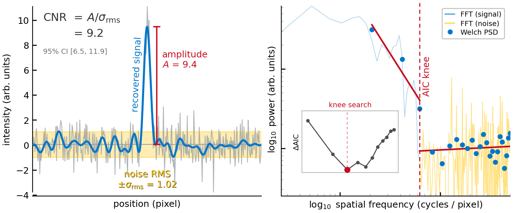

# fft-cnr

[](https://pypi.org/project/fft-cnr/)
[](https://pypi.org/project/fft-cnr/)
[](https://github.com/thiebes/fft-cnr/actions/workflows/test.yml)
[](https://fft-cnr.readthedocs.io/en/latest/)
[](LICENSE)
[](https://doi.org/10.5281/zenodo.20691435)

FFT-based contrast-to-noise ratio estimation from a single frame.



Measure the contrast-to-noise ratio (CNR) of a 1-D signal profile from a
single acquisition. You do not need repeat frames or a separate background
region.

Here CNR means the peak signal amplitude above the baseline, divided by the RMS
of the noise. The contrast is the peak's height above the baseline, the part that
stands out from the background, so dividing it by the noise gives the ratio that
governs whether the feature can be detected and measured. This is a single-peak
contrast, distinct from the two-region (difference-of-means) CNR measured with
two hand-drawn regions in MRI or CT.

`fft-cnr` uses the Fourier transform to separate the slowly varying signal from
the rapid, point-to-point noise. The package automatically finds the frequency
boundary between the two (using a model-selection score, the Akaike information
criterion or AIC) and returns a CNR estimate with a 95% confidence interval.

Full documentation is at [fft-cnr.readthedocs.io](https://fft-cnr.readthedocs.io).

## Installation

Requires Python 3.10 or later (tested on 3.10 through 3.13). If you do not have
Python installed, [download it from python.org](https://www.python.org/downloads/)
and follow the installer instructions (on Windows, check "Add Python to PATH"
when prompted).

Install into a virtual environment so the package and its dependencies stay
isolated from your other projects:

```bash
python -m venv .venv
source .venv/bin/activate   # Windows: .venv\Scripts\activate
pip install fft-cnr
```

The only runtime dependencies are numpy (>=1.24) and scipy (>=1.10); pip
installs them automatically.

## Quick start

```python
import numpy as np
from fft_cnr import fft_cnr

# Simulate a 1-D intensity profile (e.g., from a microscopy line scan)
# with additive detector noise
rng = np.random.default_rng(0)
x = np.arange(256, dtype=float)
signal = 10.0 * np.exp(-0.5 * ((x - 127) / 20) ** 2)
noisy = signal + rng.normal(0, 1.0, 256)

result = fft_cnr(noisy)

print(f"CNR:       {result.cnr:.1f}")
print(f"CNR 95%CI: ({result.cnr_ci95[0]:.1f}, {result.cnr_ci95[1]:.1f})")
print(f"Amplitude: {result.amplitude:.2f}")
print(f"Noise RMS: {result.noise_rms:.3f}")
```

```text
CNR:       9.8
CNR 95%CI: (6.9, 12.7)
Amplitude: 9.74
Noise RMS: 0.991
```

The output is deterministic given the seed, so this snippet reproduces the same
numbers on each run. The package exposes three names: the `fft_cnr` function and
its result types `CNREstimate` and `NoiseModel`.

## How it works

A smooth signal spread over many points concentrates its energy in a few
low-frequency Fourier components. Uncorrelated, point-to-point noise spreads its
energy across all frequencies. So in the power spectrum the signal sits at low
frequency and the noise dominates the high-frequency end, which is where the two
can be separated.

1. The input profile is mean-subtracted and tapered with a window function (a
   tapered cosine, or Tukey, window by default) to suppress edge artifacts in
   the Fourier transform. For the noise estimate, the Tukey taper is applied
   relative to the profile's edge level (the mean of the samples under the
   taper ramps) instead of its mean. On a short record around a localized
   feature the mean sits well above the edges, and the taper would turn that
   offset into short ramps whose power reads as noise.
2. The power spectrum is estimated by averaging the transforms of overlapping
   segments, which is smoother than a single transform (the averaged-segment, or
   Welch, method). This smoothed spectrum is used only to locate the
   signal/noise boundary in the next step.
3. The power spectrum typically shows high power at low frequencies, where the
   signal lives, that levels off to a flat noise floor at higher frequencies.
   The algorithm finds this transition by fitting two line segments in log-log
   space. It then uses the Akaike information criterion (AIC, a standard score
   that penalizes overfitting) to pick the boundary that best balances fit
   quality against model complexity.
4. The spectral bins at and below the boundary are set to zero, the remaining
   high-frequency bins are transformed back to real space, and the RMS of that
   reconstructed noise is taken. This RMS is then scaled to undo the window
   energy and the fraction of bins kept, so it estimates the full-band noise
   level.
5. Signal amplitude is estimated by one of three methods (see below), and
   CNR = amplitude / noise RMS.
6. The noise level gets a chi-squared 95% confidence interval whose degrees of
   freedom are those of the estimate itself: the tapered, band-limited power of
   the whole profile. For white noise and the default taper this is about 0.87
   times the number of samples times the fraction of the band kept (the factor
   is `mean(w**2)**2 / mean(w**4)` for the taper `w`). A 95% confidence
   interval on CNR is then computed by first-order error propagation (the
   delta method), combining the
   amplitude standard error and the noise interval as independent terms.

The method works best when the signal occupies low frequencies and the noise is
broadband (approximately white). The hard minimum length is 16 points (shorter
inputs raise `ValueError`). Reliable results need more, and how many more
depends on how much of the record the feature fills (see Profile length under
Accuracy). Signals with strong high-frequency
content that overlaps the noise band will also bias the CNR estimate.

## Amplitude estimation

By default (`fit_model=None` or `"peak"`), `fft_cnr` removes the high-frequency
noise components (by zeroing frequencies above the signal/noise boundary) and
reads the peak of the resulting smoothed profile, measured above a baseline
estimated from the outer quarter of the profile on each side. This works for any
profile shape and assumes nothing about its functional form. If the signal
extends into those outer regions, the baseline is contaminated and the amplitude
is underestimated, independent of the noise. The profile therefore needs to
extend well beyond the feature: for a Gaussian, a profile 2.7 full widths at
half maximum (FWHM) long reads the amplitude about 8.5% low, 4.1 FWHM about 1%
low, and 5.4 FWHM within 0.1%. When the profile cannot be made longer, the
matched filter does not use this baseline margin and is unaffected. The
generalized Gaussian fit does not use it either, but it still needs the record
to extend beyond most of the feature; [Profile length](#profile-length) gives
the record width each method needs.

Two alternatives are available:

- **Matched filter** (`template` parameter): when a noise-free template of the
  expected signal shape is available, a matched filter gives the most precise
  amplitude estimate and a calibrated standard error. This holds only when the
  template matches the true shape; a mismatched template biases the amplitude.
  The amplitude is in units of the template's peak, so normalize the template
  to a peak of 1 to read the amplitude, and the CNR, in signal units.

- **Generalized Gaussian fit** (`fit_model="generalized_gaussian"`): fits a
  5-parameter model with a shape exponent that covers profiles from heavy-tailed
  to flat-topped. Useful when fitted parameters (center, width, shape) are
  needed in addition to CNR. The fit runs from two starting points and keeps
  the one with the lower sum of squared residuals: the sample farthest from the
  profile's median, and the peak read of the default method (the largest
  excursion of the smoothed profile from the edge baseline, with its sign). The
  second start keeps the fit from converging to a dip of the wrong sign at an
  edge when the feature fills most of the record, where the median lies on the
  feature. The fit can still degenerate, most often on
  noise-dominated profiles, for example into a flat-topped model as wide as the
  profile whose amplitude and baseline cancel. The fit is refused at any CNR if
  its amplitude exceeds twice the data's peak-to-peak range, its width is
  pinned at the profile length, or its center is pinned at its bound, half a
  profile length outside the data. The estimate then falls back to the peak
  method, and `diagnostics["gaussian_fit_rejection_reason"]` names the reason.
  `diagnostics["gaussian_fit_params"]` is then absent, as it is when the fit
  does not converge. A feature whose peak sits at the edge of the profile can
  also meet the center condition. In validation at CNR 3 and above, the
  peak-method fallback was closer to the true amplitude there than the refused
  fit. The screen tests only
  these three conditions. A fit centered outside the profile but short of its
  bound, up to almost half a profile length outside, is kept. A runaway fit
  that meets none of the conditions is therefore still reported, so treat a
  generalized-Gaussian CNR far above the peak-method value on a noisy profile
  with caution. Its amplitude standard error comes from the fit covariance,
  which understates the scatter near CNR 2, so the CNR interval on this path
  covers about 0.92 there (see [Confidence intervals](#confidence-intervals)).

The `result.amplitude_snr` property reports the matched-filter signal-to-noise
ratio (amplitude over its standard error). A larger value means the amplitude
stands out more clearly above the noise. It is defined only on the matched-filter
(template) path, where the standard error is calibrated; on the peak and
generalized-Gaussian paths it is NaN, because those standard errors are
different quantities that are not comparable to it. Those paths still expose
`amplitude_se` directly for callers that want the raw ratio.

```python
# With a known template, normalized to a peak of 1
result = fft_cnr(noisy, template=signal / signal.max())

# With a generalized Gaussian fit
result = fft_cnr(noisy, fit_model="generalized_gaussian")
print(result.diagnostics.get("gaussian_fit_params"))  # absent on fallback
```

### Kinetic traces

To follow a feature's amplitude across a series of profiles, such as pump-probe
spectra at successive delays, use the matched filter with a template at the
feature's known position and width, and read the signed `amplitude`.

The peak method reads the largest excursion of the smoothed profile, of either
sign. Once the feature has decayed into the noise, that excursion is noise. The
signed `amplitude` then averages zero over many profiles, but it scatters by
about 1.7 noise standard deviations, against 0.10 for the matched filter. While
the feature is weak but still present (about 0.5 to 3 noise standard
deviations), the peak method reads high. The magnitude of the peak amplitude,
`cnr * noise_rms`, averages about 1.6 noise standard deviations on a profile
with no feature, so a trace built from `cnr` stops decaying at a false floor.
The generalized Gaussian fit follows both a strong decaying feature and a weak
long-lived component to within a few percent.

These statements come from a simulation of a Gaussian band (standard deviation
about 77 points in a 1024-point spectrum) that decays over 81 delays in white
noise, with 200 delay series per condition and exponential fits to each trace.
The initial CNR is the band amplitude at the first delay over the noise level.
The weak long-lived component has 0.2 of the initial amplitude and ten times
the fast lifetime.

| Amplitude read from | Single-exponential lifetime, initial CNR 10 / 20 | Long-lived lifetime, initial CNR 10 / 20 |
| ------------------------- | ------------------------- | ------------------------- |
| Matched filter | within 0.1% | within 0.6% |
| Peak method, `amplitude` | 6.7% / 2.4% long | 71% / 56% long |
| Generalized Gaussian fit | within 0.2% | 3.4% short / 1.3% long |

A single-exponential fit with a constant offset to the magnitude trace returns
a false offset of 15% of the initial amplitude at an initial CNR of 10 and 7%
at 20. On profiles where the band has decayed, the generalized Gaussian fit
falls back to the peak method in about 3% of cases.

## Noise model detection

The CNR above treats the noise as one number, which is correct when the noise
is the same at every point (for example, detector read noise). Photon-counting
measurements break this assumption. Shot noise grows with the local signal, so
the noise under the peak is larger than the average noise. Because `cnr` divides
the peak by the average noise, it overestimates the true peak signal-to-noise
ratio, and the size of the error depends on the profile shape.

Setting `estimate_noise_model=True` makes `fft_cnr` test for this. It fits the
photon-transfer relation (variance = gain * signal + read^2) to its own
residual, a single-frame surrogate for a photon-transfer curve that is
conventionally measured from many exposures, and attaches a `NoiseModel` to the
result:

```python
result = fft_cnr(noisy, estimate_noise_model=True)
model = result.noise_model

if model.signal_dependent:
    # Noise grows with the signal; result.cnr overestimates the peak SNR.
    # The fitted noise model gives the corrected value:
    print(f"Peak SNR: {model.peak_snr(result.amplitude):.1f}")
```

`model.signal_dependent` is `True` when the fitted gain is statistically
significant, `False` when the noise is consistent with a constant level, and
`None` when the profile's signal range is too small to test (the reason
appears in `diagnostics["noise_model_skipped"]`). To judge significance, the
package runs the whole estimation pipeline on about 200 simulated data sets, so
the test accounts for the estimator's own artifacts. These extra runs cost
roughly half a second at N=512.

`peak_snr` evaluates the fitted variance at the feature's extremum. It starts
from `model.baseline_variance`, the fitted variance at the profile's baseline,
and adds `gain * amplitude` with the amplitude signed. `model.baseline` is the
edge level that the peak read subtracts: the mean of the outer quarter of the
samples at each end. Most samples sit near that level, so the fitted variance
there is well constrained. A photon background therefore adds its shot noise to
the noise at the peak, and a detector offset, which carries no shot noise, does
not. A negative (absorption or dark-contrast) feature is evaluated at its
bottom, where the signal-dependent noise is lowest. A negative fitted gain is
treated as zero. The amplitude must be in signal units, which on the
matched-filter path holds for a template with a peak of 1. When the feature
reaches the outer quarters of the profile, the baseline includes part of the
feature and the amplitude reads low (see
[Confidence intervals](#confidence-intervals)), and `peak_snr` reads low by
about the same fraction.

`model.baseline_variance` is an unclipped estimate. When the true variance at
the baseline is small against its estimation error, it is zero or negative on
a sizeable share of profiles, and the floor variance is then not resolved from
zero. On a zero-background Poisson profile (peak of 25 or 100 photons, N=512,
200 trials) this happened in 41% to 44% of profiles with no read noise, in 0%
to 13% with a read noise of 1 count, and in none from 2 counts. Treat a
non-positive value as zero when forming a floor-referenced level: the
floor-referenced CNR, `abs(amplitude) / sqrt(model.baseline_variance)`, is then
unbounded for that profile, and a level pooled over a series of profiles is the
median of the clipped per-profile values. `peak_snr` returns NaN, without a
warning, only if the variance at the extremum is also not positive; in the same
trials that did not occur.

When the gain is significant, the fitted variance also sets the intervals:
`noise_ci95`, `amplitude_se` on the peak and matched-filter paths, and
`cnr_ci95` use it in place of the single noise level, and
`diagnostics["interval_noise"]` reads `"signal_dependent"`. The default
intervals assume white noise; under shot noise they are too narrow, because the
noise is largest under the peak, which is where the amplitude estimate puts its
weight. Use `estimate_noise_model=True` for photon-limited data when the
intervals matter.

The detection is deterministic by default: the same input always produces the
same result. Pass your own random generator (`rng=np.random.default_rng()`)
to draw an independent simulation instead.

Estimating a Poisson-Gaussian noise model from a single image is established
prior art, most notably the single-image method of Foi et al. (IEEE Trans.
Image Process. 17, 1737 (2008)). This detector does not claim to be first at
single-frame noise estimation. What it adds is to fold the photon-transfer fit
into the spectral decomposition the CNR already computes, gated by a
significance test calibrated through the same pipeline.

### Correlated (1/f) noise is not corrected

Signal-dependence is one way the constant-noise assumption fails. Spatially
correlated, 1/f-type noise is a separate one. It arises when temporal drift maps
onto a spatial direction, as in galvo raster scanning or streak cameras. The
drift puts noise power at low spatial frequency, where `fft_cnr` reads signal,
so it biases `cnr` high.

The `NoiseModel` has fields for this case (`spectral_exponent`, `white_floor`,
and `correlated`), but they are reserved and not filled in: the two floats stay
NaN and the flag stays None. Single-frame quantitative correction of correlated
noise is not supported, and the reason is an identifiability limit. The signal
and the 1/f noise both live in the low frequencies, and a single profile gives
one measurement, so there is no way to tell how much of the low-frequency power
is signal and how much is drift; any split fits the data equally well.
Separating them needs a second, independent view in which the signal repeats but
the noise does not: multiple frames, an interleaved scan, or a reference
channel. Those are also the way to correct correlated noise once it is detected.

## Low-frequency baseline and structured background

A smooth baseline, a slow trend or a single low-frequency fringe, sits entirely
below the signal/noise boundary, so `fft_cnr` reads it as signal. With a strong
baseline the peak-method `cnr` can stay high even for a profile with no peak.
Two tools address this:

- `diagnostics["lowfreq_dominated"]` (with the underlying
  `lowfreq_offpeak_ratio`) is true when low-frequency structure away from the
  peak exceeds 2.5 times the noise RMS. It marks profiles where the reported
  `cnr` may reflect baseline power rather than the peak. The flag is set on the
  peak and generalized-Gaussian methods and is not set on the matched-filter
  path, where the template defines the signal.
- `roi` restricts the estimate to a window around the peak, removing off-center
  baseline structure. Pass explicit `(start, stop)` bounds, or `"auto"` to size
  a window to the peak. `"auto"` locates the largest feature, so pass explicit
  bounds when an off-center baseline is larger than the peak of interest.

This guard is calibrated for smooth, low-order baselines. Broadband structured
background is a different problem. The residual speckle and fringe field left
after interferometric scattering microscopy (iSCAT) background subtraction is
the representative case: its power spans many spatial frequencies, including the
high-frequency band that sets the noise estimate. It both inflates the noise
RMS, which suppresses real peaks, and adds low-frequency amplitude, which raises
peakless frames, so the peak-method `cnr` is unreliable and `lowfreq_dominated`
does not detect it. This is correlated noise (see above) and cannot be
characterized from a single frame.

For this regime, use the matched filter: pass the known signal shape as
`template` and read `amplitude` and `amplitude_snr` rather than `cnr`. The
projection onto the template rejects background that does not match the template
shape, so the amplitude and its SNR stay accurate where `cnr` does not. For
iSCAT the template is the interferometric point-spread function. The
`scripts/validate_iscat_baseline.py` simulation documents this behavior.

## Return value

`fft_cnr` returns a `CNREstimate` dataclass. The first five fields are the
primary outputs; `cutoff_index`, `diagnostics`, and `noise_model` are for
advanced inspection.

| Field | Type | Description |
| -------------- | ---------------------- | --------------------------------------------------- |
| `cnr` | `float` | Estimated contrast-to-noise ratio |
| `cnr_ci95` | `tuple[float, float]` | 95% confidence interval on CNR |
| `amplitude` | `float` | Signal amplitude estimate (signed on the peak path: negative for a dip) |
| `amplitude_se` | `float` | Standard error of the amplitude estimate |
| `amplitude_snr` | `float` (property) | Matched-filter SNR (amplitude over its standard error); NaN on the peak and generalized-Gaussian paths |
| `noise_rms` | `float` | RMS noise from the high-frequency spectral region |
| `noise_ci95` | `tuple[float, float]` | 95% confidence interval on noise RMS |
| `cutoff_index` | `int` | Spectral index of the signal/noise boundary |
| `diagnostics` | `dict` | Welch parameters, DOF, amplitude method, fit params, low-frequency baseline guard (`lowfreq_dominated`, `lowfreq_offpeak_ratio`), peak-read sign-ambiguity flag (`amplitude_sign_ambiguous`), generalized-Gaussian fit-refusal reason (`gaussian_fit_rejection_reason`), the noise the intervals assume (`interval_noise`), and `roi` bounds when set |
| `noise_model` | `NoiseModel \| None` | Fitted noise structure (`None` unless requested) |

## Parameters

Most users will only need `x` (and optionally `template` or `fit_model`). The
remaining parameters control internal details of the spectral estimation and
rarely need adjustment.

| Parameter | Default | Description |
| ---------------------- | --------------- | --------------------------------------------------------- |
| `x` | (required) | 1-D signal array (length >= 16) |
| `template` | `None` | Noise-free template for matched-filter estimation |
| `fit_model` | `None` | Amplitude method: `None`/`"peak"` for spectral low-pass, `"generalized_gaussian"` for parametric fit |
| `window` | `"tukey"` | Taper window: `"tukey"`, `"hann"`, or `"none"` |
| `tukey_alpha` | `0.25` | Tukey window shape parameter |
| `welch_nperseg` | `None` | Welch segment length (defaults to `max(16, N//8)`) |
| `welch_noverlap` | `None` | Welch overlap (defaults to `nperseg // 2`) |
| `cutoff_guard` | `(0.05, 0.5)` | Fractional frequency bounds for signal/noise boundary search |
| `fallback_cut_frac` | `0.25` | Fallback signal/noise boundary if AIC selection fails |
| `roi` | `None` | Restrict to a region of interest: `(start, stop)` bounds or `"auto"` (see Low-frequency baseline and structured background) |
| `return_bandpassed_noise` | `False` | Include the bandpassed noise array in diagnostics |
| `estimate_noise_model` | `False` | Fit and test the noise model (see Noise model detection) |
| `rng` | `None` | Generator for the noise-model test; `None` is deterministic |

The minimum accepted length is 16 points. Reliable results need more; see How it
works for guidance on length.

## Accuracy

Monte Carlo validation (200 trials per condition, `scripts/validate_accuracy.py`)
characterizes bias and precision across five signal shapes: Gaussian, heavy-tailed (generalized Gaussian, p=1.5),
flat-topped (p=4), Gaussian mixture, and Lorentzian. All conditions use additive
white Gaussian noise, the regime the method assumes, so the headline accuracy
numbers inherit that assumption.

### Bias

Median estimated-to-true CNR ratio at N=512, by amplitude method:

| Shape | Peak | Gen. Gaussian | Matched filter |
| ----------------------- | ----------- | ------------- | -------------- |
| Gaussian | 1.00--1.03 | 1.00--1.01 | 1.00--1.01 |
| Heavy-tailed (p=1.5) | 0.97--1.00 | 0.99--1.01 | 0.98--1.00 |
| Flat-topped (p=4) | 0.93--1.10 | 0.93--1.01 | 0.92--1.00 |
| Gaussian mixture | 0.99--1.01 | 1.12--1.17 | 0.99--1.00 |
| Lorentzian | 0.98--1.01 | 1.06--1.09 | 0.99--1.00 |

The peak method stays within 3% of the true CNR for most shapes from CNR=5
upward. The main exception is flat-topped profiles (up to 7% positive bias at
CNR=3, 7% negative at CNR=100). The negative bias at high CNR comes from the
noise estimate, not the amplitude, so it affects every amplitude method equally:
the sharp shoulders of a flat-topped profile put signal power above the
signal/noise boundary, where it is counted as noise. That leaked power is
fixed while the noise falls, so the noise level reads progressively high as the
CNR rises (for p=4 and sigma=20 samples, 2% high at CNR=50, 8% at CNR=100, and
29% at CNR=200, where the CNR reads about 0.77 of the true value and the
`lowfreq_dominated` flag does not fire; a diagnostic for this case is tracked
in issue #15). A wider feature of the same shape leaks less and holds its
accuracy to higher CNR. The generalized Gaussian fit is accurate when the
signal is in the model family but introduces 6--17% positive bias on shapes
outside it (Gaussian mixture, Lorentzian). The matched filter tracks the true
CNR to within 2% when the template matches the signal shape.

### Profile length

Shorter profiles reduce accuracy slightly. At N=128 (peak method, Gaussian
signal with sigma=20 samples), the estimator shows 6--8% negative bias at high
CNR. This is the baseline margin described under
[Amplitude estimation](#amplitude-estimation), not the noise estimate: the
profile is only 2.7 FWHM long, so the outer-quarter baseline sits on the
Gaussian's tails and the amplitude reads about 8.5% low even without noise.

| N | CNR=5 | CNR=20 | CNR=100 |
| ------- | --------- | --------- | --------- |
| 128 | 1.03 | 0.94 | 0.93 |
| 256 | 1.03 | 1.00 | 1.00 |
| 512 | 1.01 | 1.01 | 1.00 |

Records much shorter than 128 points work when the feature is narrow enough to
leave some baseline at the edges. For a Gaussian feature in a record spanning
+/-4 standard deviations (N=28, 40, and 52; 2000 trials per condition,
`scripts/validate_interval_coverage.py --lengths 28 40 52 --width-to-length 0.125`),
the median CNR ratio from CNR=5 to 100 at N=40 and 52 is 1.00--1.01 on the
matched filter, 1.01--1.04 on the generalized Gaussian fit, and 0.98--1.02 on
the peak method. At N=28 and CNR=100 the coarse cutoff leaves some of the
feature's own power in the noise band, so the noise level reads 4% high, and
the CNR reads 0.95 (matched filter), 0.96 (generalized Gaussian), and 0.92
(peak, whose amplitude also reads a few percent low on short records) of the
true value.

Narrower records cut into the feature itself. For a centred Gaussian in a
record of +/-k standard deviations (records of 16 to 52 points, 1800 profiles
per condition, `scripts/validate_record_width.py`), the generalized Gaussian
fit reads the median CNR within 3% of the simulated value down to k = 2.5 from
CNR=5, and down to k = 2 from CNR=13. Below that the fit cannot separate
amplitude, baseline, and shape. More fits run away into a flat top as wide as
the record and are refused, and the refused fits fall back to the peak method.
At k = 1.5 the median reads 0.63 to 0.81 of the simulated value from CNR=5 to
34, and 20% to 35% of fits are refused. The peak method reads its edge baseline
on the feature's tails whenever k is below about 4: its noiseless read is 0.97,
0.94, 0.89, 0.80, 0.66, and 0.47 of the true amplitude at k = 4, 3.5, 3, 2.5,
2, and 1.5 (issue #37). The matched filter does not use the baseline margin.

### Precision

Trial-to-trial scatter (relative standard deviation) scales as roughly
1/sqrt(N): approximately 11% at N=128, 7% at N=256, and 5% at N=512 (peak
method, CNR=5). Providing a matched template reduces scatter at low CNR.

### Confidence intervals

Coverage of the 95% intervals was measured on white Gaussian noise with a
Gaussian feature (2000 trials per condition,
`scripts/validate_interval_coverage.py`). The noise interval `noise_ci95`
contains the true noise level in 93 to 95% of trials for N from 64 to 1024, and
in 94 to 96% for the short records described under Profile length (92% at N=28
and CNR=100). From CNR=5 the CNR interval on those short records covers 0.92 to
0.97 on every method. The exception is a feature narrow enough to put its own
power above the signal/noise boundary: at N=64 a Gaussian feature with
sigma=3.1 samples (FWHM about 7.4) reads the noise 1.44 times high at CNR=100,
and the noise interval covers 0.36. The
CNR interval combines the amplitude standard error and the noise interval as
independent terms; its coverage and median width (relative to the true CNR) are:

| Method | CNR=2 | CNR=5 | CNR=10--100 | Width at CNR=20 (N=256 / 512) |
| -------------- | ----------- | ----------- | ----------- | ----------------------------- |
| Peak | 0.91--0.93 | 0.94--0.95 | 0.94--0.95 | 0.22 / 0.15 |
| Gen. Gaussian | 0.92--0.93 | 0.94--0.95 | 0.94--0.95 | 0.21 / 0.15 |
| Matched filter | 0.95 | 0.95 | 0.95 | 0.21 / 0.14 |

The reported standard errors match the trial-to-trial scatter: their ratio is
0.98 to 0.99 for the noise level on every method, and 0.91 to 1.05 for the
amplitude on the peak and matched-filter methods. Two limits remain. On the
peak method at CNR=2 the maximum of the noisy reconstruction biases the CNR
10--19% high, which no standard error can absorb; below CNR=3 the matched
filter is the better choice. On the generalized-Gaussian method at CNR=2 the
fit covariance understates the amplitude scatter (their ratio is 0.82 to 0.83),
so the interval covers 0.92 to 0.93 instead of 0.95.

These figures are for a feature centered in the profile. On the peak method the
interval also assumes that the feature has decayed within the outer quarters of
the profile, where the baseline is read (see
[Amplitude estimation](#amplitude-estimation)). A feature that reaches them is
read low, and the interval, whose width reflects only the noise, does not cover
that bias. For a Gaussian with sigma=30 samples centered on the first sample of
a 512-point profile, the peak method reads the CNR at 0.84 of the true value and
its interval covers 0.04; for the same feature centered at 0.15 of the profile
length, 0.72 and 0.00 (1000 trials each). A centered Gaussian with sigma=60
samples (3.6 FWHM in the profile) covers 0.90 to 0.92 at CNR=20 to 50. The
matched filter does not use this baseline and covers 0.94 to 0.95 in all three
cases, so use it, or
`roi` bounds that leave margin on both sides of the feature, when the feature
is near the edge of the profile.

Under shot noise the default intervals assume one noise level and are too
narrow: with a background of 10 counts and CNR 20, the CNR interval covers 0.84
(matched filter) and 0.82 (peak). With `estimate_noise_model=True` the detector
fires on such data and the intervals use the fitted variance, which restores
coverage to 0.95 on both methods. The reference noise level there is the
taper-weighted root mean variance, `sqrt(mean(w**2 * var) / mean(w**2))`,
which `noise_rms` estimates; it exceeds the plain root mean variance by up to
7.5% when a strong peak sits over a weak background.

### Noise model detection

Monte Carlo validation of the signal-dependence test (100 trials per
condition, `scripts/validate_noise_model.py`) covers white noise, where the
test should stay quiet, and Poisson counts, where it should fire. Conditions
span Gaussian and flat-topped profiles, N in {256, 512}, and CNR 5--20; no
trial was skipped for insufficient signal range.

| Regime | Flag rate | Median gain | Median read |
| --------------------------------------- | ------------------ | ---------------- | ----------- |
| White noise (truth: gain 0, read 1) | 2--7% (nominal 5%) | -0.004 to +0.007 | 0.99--1.00 |
| Poisson counts (truth: gain 1, read 0) | 100% | 0.95--1.02 | -- |

On white noise the false-positive rate is consistent with the 5% test level
and the fitted parameters recover the truth. On Poisson data the test fired in
all 100 trials at these conditions, the fitted gain is within 5% of the true
value, and the derived peak SNR tracks the true peak signal-to-noise ratio
(ratio 0.99 to 1.03 across N and CNR). For a 100-photon Poisson peak on a
background of 0 to 100 photons, a 100-photon dip on 300, or a detector offset
of 0 to 1000 counts with read noise 2, the median ratio stays within 0.99 to
1.03 (200 trials each).

Under a detector offset the fitted read floor clips at zero, so the fitted
variance that sets the intervals is too large and the intervals are
conservative: `amplitude_se` is 1.8 times the observed scatter at a 100-count
offset and 4.3 times at 1000 counts. `cnr` itself is unaffected by an offset.

## Citation

If you use fft-cnr in published work, please cite it with the concept DOI below,
which always resolves to the latest release, and report the version you used
(`pip install fft-cnr==0.4.2`).

> Joseph J. Thiebes. fft-cnr: FFT-based contrast-to-noise ratio estimation from
> a single frame. Zenodo. https://doi.org/10.5281/zenodo.20691435

```bibtex
@software{thiebes_fft_cnr,
  author    = {Thiebes, Joseph J.},
  title     = {fft-cnr: FFT-based contrast-to-noise ratio estimation from a single frame},
  version   = {0.4.2},
  year      = {2026},
  publisher = {Zenodo},
  doi       = {10.5281/zenodo.20691435},
  url       = {https://doi.org/10.5281/zenodo.20691435}
}
```

Citation metadata is in [CITATION.cff](CITATION.cff); GitHub's "Cite this
repository" button generates APA and BibTeX from it.

## Background

The spectral decomposition approach used here originated in a study of noise
effects on diffusion coefficient estimation in chemical transport imaging
(Thiebes & Grumstrup, 2024). This package has evolved from the method described
in that paper. The power-spectrum estimation, knee detection, and
confidence-interval machinery all differ from the original.

Support for non-Gaussian profiles was motivated by work on excess kurtosis
in exciton transport (Arévalo Rodríguez et al., 2026).

**Methods and background.** The package implements established signal-processing
and sensor-characterization methods: averaged-periodogram power-spectrum
estimation (Welch, 1967), window tapering for harmonic analysis (Harris, 1978),
model selection by the Akaike information criterion (Akaike, 1974), matched
filtering (North, 1963; Turin, 1960), the estimation-theory framework for
standard errors and the Cramér-Rao bound on estimator variance (Kay, 1993), and
the photon-transfer characterization of sensor noise (Janesick, 2007; EMVA
Standard 1288). Estimating a Poisson-Gaussian noise model from a single image is
established separately (Foi et al., 2008); this package folds a photon-transfer
fit into the spectral decomposition it already computes rather than
reimplementing that method. Full references with DOIs are listed under
[References](#references) below; machine-readable citation metadata is in
[CITATION.cff](CITATION.cff).

## References

- Akaike, H. (1974). A new look at the statistical model identification.
  *IEEE Transactions on Automatic Control*, 19(6), 716-723.
  [doi:10.1109/TAC.1974.1100705](https://doi.org/10.1109/TAC.1974.1100705)
- Arévalo Rodríguez, E., Meléndez, M., Cuadra, J., & Prins, F. (2026).
  *Journal of Physical Chemistry Letters*, 17, 2479-2484.
  [doi:10.1021/acs.jpclett.5c03961](https://doi.org/10.1021/acs.jpclett.5c03961)
- European Machine Vision Association (2021). *EMVA Standard 1288: Standard for
  Characterization of Image Sensors and Cameras*, version 4.0.
  [emva.org](https://www.emva.org)
- Foi, A., Trimeche, M., Katkovnik, V., & Egiazarian, K. (2008). Practical
  Poissonian-Gaussian noise modeling and fitting for single-image raw-data.
  *IEEE Transactions on Image Processing*, 17(10), 1737-1754.
  [doi:10.1109/TIP.2008.2001399](https://doi.org/10.1109/TIP.2008.2001399)
- Harris, F. J. (1978). On the use of windows for harmonic analysis with the
  discrete Fourier transform. *Proceedings of the IEEE*, 66(1), 51-83.
  [doi:10.1109/PROC.1978.10837](https://doi.org/10.1109/PROC.1978.10837)
- Janesick, J. R. (2007). *Photon Transfer*. SPIE Press.
  [doi:10.1117/3.725073](https://doi.org/10.1117/3.725073)
- Kay, S. M. (1993). *Fundamentals of Statistical Signal Processing, Volume I:
  Estimation Theory*. Prentice Hall. ISBN 978-0-13-345711-7.
- North, D. O. (1963). An analysis of the factors which determine signal/noise
  discrimination in pulsed-carrier systems. *Proceedings of the IEEE*, 51(7),
  1016-1027. [doi:10.1109/PROC.1963.2383](https://doi.org/10.1109/PROC.1963.2383)
- Thiebes, J. J., & Grumstrup, E. M. (2024). *Journal of Chemical Physics*,
  160, 124201. [doi:10.1063/5.0190347](https://doi.org/10.1063/5.0190347)
- Turin, G. L. (1960). An introduction to matched filters. *IRE Transactions on
  Information Theory*, 6(3), 311-329.
  [doi:10.1109/TIT.1960.1057571](https://doi.org/10.1109/TIT.1960.1057571)
- Welch, P. D. (1967). The use of fast Fourier transform for the estimation of
  power spectra: A method based on time averaging over short, modified
  periodograms. *IEEE Transactions on Audio and Electroacoustics*, 15(2), 70-73.
  [doi:10.1109/TAU.1967.1161901](https://doi.org/10.1109/TAU.1967.1161901)

## Acknowledgments

Thanks to Ferry Prins and Enrique Arévalo Rodríguez for discussions on
non-Gaussian transport profiles that informed the design of this package.

## Contributing and community

Contributions, bug reports, and feature requests are welcome. See
[CONTRIBUTING.md](CONTRIBUTING.md) for development setup, how to run the tests,
and how to submit changes. Participation is governed by the
[Code of Conduct](CODE_OF_CONDUCT.md).

## Development disclosure

The method, design, and direction of this package are the author's own. It
builds on the author's prior work: the spectral contrast-to-noise estimator
introduced in Thiebes and Grumstrup (2024) and developed further in the
[DICE](https://github.com/thiebes/DICE) repository (see [Background](#background)). The estimator's
structure, the choices behind each pipeline step, the validation strategy, and
the critique that shaped successive revisions all reflect the author's own
thinking.

Generative AI tools (Anthropic Claude) assisted primarily with code: drafting
implementations from the author's specifications, writing tests, and editing
documentation. The author directed this work, reviewed and corrected every
contribution, and characterized the estimator by the Monte Carlo validation
reported under [Accuracy](#accuracy).

## License

Released under the MIT License; see the [LICENSE](LICENSE) file for the full
text.
